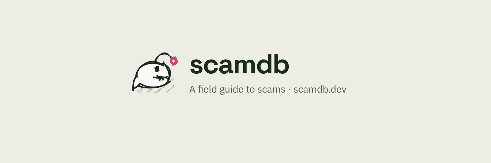
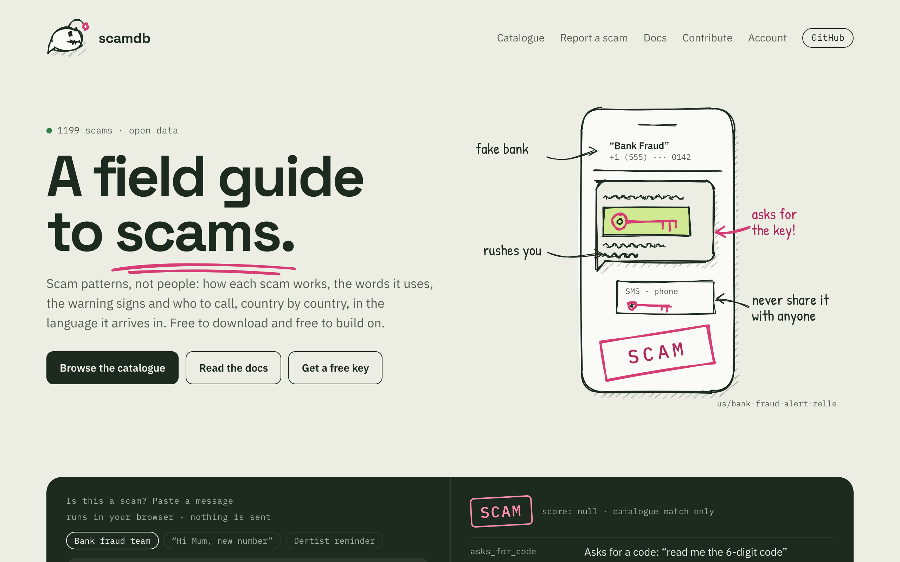
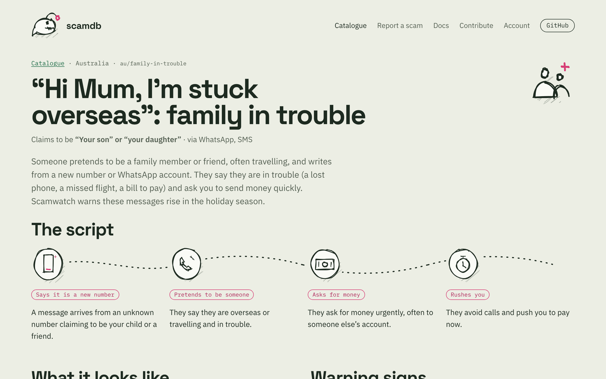

<p align="center">
  <a href="https://scamdb.dev"></a>
</p>

<p align="center">
  <strong>An open database of the world's scam patterns, and a free API that tells you whether a message is a scam.</strong>
</p>

<p align="center">
  <a href="https://github.com/nahuelsantos/scamdb/actions/workflows/ci.yml"></a>
  <a href="https://scamdb.dev"></a>
  <a href="https://scamdb.dev/docs/"></a>
  <a href="LICENSE-DATA"></a>
  <a href="LICENSE"></a>
</p>

<p align="center">
  <a href="https://scamdb.dev">Website</a> ·
  <a href="https://scamdb.dev/catalogue/">Catalogue</a> ·
  <a href="https://scamdb.dev/docs/">API docs</a> ·
  <a href="https://scamdb.dev/report/">Report a scam</a> ·
  <a href="CONTRIBUTING.md">Contribute</a>
</p>

---

Phone numbers and links in scam blacklists go stale every week. **The script of a scam lasts for years.** scamdb
catalogues those scripts: who the scammer pretends to be, what they ask for, how they pressure you, the warning signs,
what to do and who to report it to. Every pattern is built from real, documented scams with a reliable, dated source,
and real messages are stored in the language they arrive in.

<table>
  <tr>
    <td align="center"><strong>1,199</strong><br>scam patterns</td>
    <td align="center"><strong>76</strong><br>countries</td>
    <td align="center"><strong>43</strong><br>languages</td>
    <td align="center"><strong>2,500+</strong><br>dated sources</td>
    <td align="center"><strong>7</strong><br>channels</td>
  </tr>
</table>

<sub>WhatsApp, SMS, social media, phone calls, websites, email and in person. Figures as of November 2026; the live
numbers are in <a href="https://scamdb.dev/v1/index.json"><code>/v1/index.json</code></a>.</sub>

<p align="center">
  <a href="https://scamdb.dev">
    <picture>
      <source media="(prefers-color-scheme: dark)" srcset="docs/screenshots/home-desktop-dark.png">
      
    </picture>
  </a>
</p>

## Is this a scam? Try it

```bash
curl -s https://scamdb.dev/v1/isitascam \
  -H 'content-type: application/json' \
  -d '{"text": "Hi Mum, I dropped my phone, this is my new number. Can you transfer $450 today? I need to pay a bill urgently", "country": "au"}'
```

<details>
<summary><strong>Response</strong> (trimmed)</summary>

```json
{
  "verdict": "scam",
  "signals": [
    { "id": "urgency",       "label": "Rushes you",              "evidence": "today" },
    { "id": "money_request", "label": "Asks for money",          "evidence": "transfer" },
    { "id": "amount",        "label": "Mentions an amount",      "evidence": "$450" },
    { "id": "new_number",    "label": "Says it is a new number", "evidence": "new number" }
  ],
  "matches": [
    {
      "id": "au/family-in-trouble",
      "name": "“Hi Mum, I’m stuck overseas”: family in trouble",
      "page": "https://scamdb.dev/catalogue/au/family-in-trouble/"
    }
  ],
  "pattern": "known",
  "seenElsewhere": [
    { "id": "be/coucou-maman-new-number", "country": "be", "name": "“Hi mum, this is my new number”: your child urgently needs money" }
  ],
  "whatToDo": [
    "Call the person on the number you already have for them.",
    "Ask a personal question a scammer couldn’t answer.",
    "Don’t use the contact details in the message."
  ],
  "reportTo": "https://scamdb.dev/v1/au/contacts.json"
}
```

</details>

You get a verdict (`scam`, `suspicious` or `not_recognised`), each warning sign with the exact words that triggered it,
the closest scams in the catalogue (including ones documented in other countries and languages), what to do and who to
report it to. Paste a message on [scamdb.dev](https://scamdb.dev) to try it in the browser: that check runs locally and
nothing is sent.

| | Without a key | With a free key |
|---|---|---|
| Checks per day | 10 per IP | 50 |
| Catalogue matcher and warning signs | ✓ | ✓ |
| AI score (Workers AI, falls back to the matcher) | | ✓ |
| Screenshots (`-F image=@shot.png`) and voice notes (`-F audio=@note.ogg`), never stored | | ✓ |

Get a key by signing in with GitHub at [scamdb.dev/account](https://scamdb.dev/account/). How the verdict is made, and
how accuracy is measured on real messages only, is explained in [docs/detection.md](docs/detection.md).

## Use the data

The whole catalogue is static JSON at `https://scamdb.dev/v1/`: **no key, no rate limit, CORS open.**

```js
const res = await fetch('https://scamdb.dev/v1/gb/scams.json');
const { data } = await res.json();
for (const scam of data) console.log(scam.id, scam.name.en, scam.redFlags.en);
```

| Endpoint | Content |
|---|---|
| `GET /v1/index.json` | Dataset version, build date, countries, counts, license |
| `GET /v1/countries.json` | Countries and their languages |
| `GET /v1/signals.json` | The warning-sign vocabulary |
| `GET /v1/{country}/scams.json` | Every entry for a country |
| `GET /v1/{country}/contacts.json` | Who to report to in that country |
| `GET /v1/scams/{country}/{slug}.json` | One entry |
| `GET /v1/scams.json` | Every entry, all countries |
| `GET /v1/scamdb.zip` | The full dataset as a download |
| `GET /v1/changes.json` | Recent additions and edits, newest first |
| `POST /v1/isitascam` | Is this message a scam? `{ "text", "country"?, "lang"?, "report"? }` |
| `POST /v1/reports` | Send a scam privately (Turnstile token or key) |

Every static file is wrapped as `{ "license", "attribution", "version", "data" }`. Full reference:
[scamdb.dev/docs](https://scamdb.dev/docs/).

### What an entry holds

Each scam is one JSON file in [`data/<country>/scams/`](data), validated against [`schema/entry.schema.json`](schema/entry.schema.json):

- **The script**, step by step, each step tagged with its warning sign
- **Real messages** quoted from a source, in their original language, with numbers and links replaced by placeholders
- **Everyday phrases** people use to describe it ("they asked me for a code")
- **Warning signs**, both as ids from [`signals.json`](data/signals.json) and in plain words
- **What to do** and **who to report to**, with official contacts that are re-checked every week
- **Sources**: title, publisher, link and date for every claim

Text is stored in the scam's original language and in English.

<p align="center">
  <a href="https://scamdb.dev/catalogue/au/family-in-trouble/"></a>
</p>

<details>
<summary><strong>Countries covered</strong> (76)</summary>

<br>

Albania · Argentina · Armenia · Australia · Austria · Azerbaijan · Belarus · Belgium · Belize · Bolivia · Bosnia and
Herzegovina · Brazil · Bulgaria · Canada · Chile · Colombia · Costa Rica · Croatia · Cyprus · Czechia · Denmark ·
Ecuador · El Salvador · Estonia · Finland · France · Georgia · Germany · Greece · Guatemala · Honduras · Hungary ·
Iceland · India · Indonesia · Ireland · Italy · Japan · Kosovo · Latvia · Lithuania · Luxembourg · Malta · Mexico ·
Moldova · Montenegro · Netherlands · New Zealand · Nicaragua · Nigeria · North Macedonia · Norway · Panama · Paraguay ·
Peru · Philippines · Poland · Portugal · Romania · Russia · Serbia · Slovakia · Slovenia · South Korea · Spain · Sweden ·
Switzerland · Taiwan · Thailand · Türkiye · Ukraine · United Arab Emirates · United Kingdom · United States · Uruguay ·
Venezuela

</details>

## Principles

- **Patterns, not people.** No blacklists of numbers, no personal data. Scripts outlive the numbers they come from.
- **No source, no scam.** Every pattern rests on real, documented scams with a reliable, dated source.
- **Written examples are always flagged.** Messages we write for languages with no real example are marked
  `synthetic: true` and never count towards accuracy.
- **Accuracy is the product.** Every detection change is measured on real messages across all countries before it
  ships, with special care not to flag genuine messages.
- **Free to use, free to build on.** Data CC BY 4.0, code MIT.

More in [docs/vision.md](docs/vision.md).

## Contribute

Every scam is one file, and every change is reviewed before it goes live.

- **Add or fix a scam**: edit `data/<country>/scams/<slug>.json` and open a pull request. See [CONTRIBUTING.md](CONTRIBUTING.md).
- **Something wrong or out of date?** [Open a correction](https://github.com/nahuelsantos/scamdb/issues/new?template=correction.yml).
- **Received a scam?** [Report it privately](https://scamdb.dev/report/). Reports are read by a person and never published.

## Development

Requires Node.js 22 or newer.

```bash
npm ci
```

```bash
npm run validate   # check every entry against the schema and the rules
```

```bash
npm test           # unit and Worker tests
```

```bash
npm run serve      # build the API and the site into dist/ and serve them on localhost:8080
```

`npm run e2e` runs the browser tests (playground, accessibility, phone width) and `npm run eval` measures detection
accuracy. CI runs validation, tests, the build and the browser tests on every push and pull request.

<details>
<summary><strong>Repository layout</strong></summary>

<br>

| Path | What it is |
|---|---|
| `data/` | The catalogue: countries, warning signs, and one folder per country with its scams and contacts |
| `schema/` | JSON Schemas for every data file |
| `packages/matcher/` | The keyword and phrase matcher, used by the API and in the browser |
| `worker/` | The Cloudflare Worker: `isitascam`, reports, keys, GitHub sign-in |
| `site/` | Templates and assets for scamdb.dev (hand-drawn look, see [DESIGN.md](DESIGN.md)) |
| `lib/`, `tools/` | Build, validation, import and maintenance scripts |
| `eval/` | Labelled messages and accuracy reports |
| `migrations/` | D1 database migrations |
| `tests/` | Unit, Worker and browser tests |
| `docs/` | Vision, detection, sources and [operations](docs/operations.md) (deploy and owner steps) |

</details>

## License

- **Data** (`data/` and everything under `/v1/`): [CC BY 4.0](LICENSE-DATA). Use it for anything, including
  commercially, as long as you credit it as **scamdb.dev · CC BY 4.0**, link to the license and say if you changed it.
- **Sources, media and quoted real messages** belong to their publishers. scamdb links to and briefly quotes them with
  credit; they are not covered by CC BY.
- **Code**: [MIT](LICENSE).

<p align="center"><sub>Made by the people behind <a href="https://eschamuyo.com">eschamuyo.com</a>.</sub></p>
